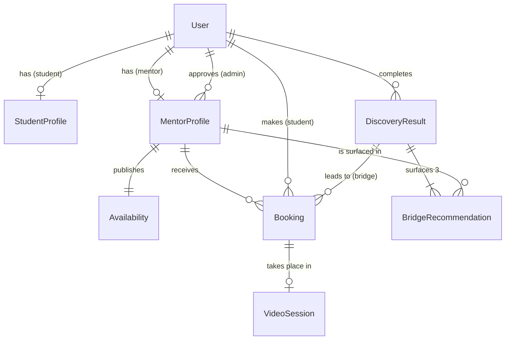

# Pathora data model (MongoDB)

Pathora stores everything in MongoDB, through Mongoose models in [`lib/db/models/`](../lib/db/models/). The models are the schema: field types, validation rules and indexes are declared there, and `npm run seed` builds the indexes in the database.

This document is the readable version of that schema. Each rule below links to the check that proves it, in `npm run verify` (offline) or `npm run verify:db` (against a live database).

## Collections

Twelve collections. Most run the application; `bridgerecommendations`, `verifiedresources`, `analyticsevents` and `videosessions` hold the research data.

| Collection (model) | Holds |
| --- | --- |
| `users` (`User`) | Every account: name, email, role (`student`, `mentor` or `admin`) |
| `studentprofiles` (`StudentProfile`) | A student's university, field, year, country, consent, and pseudonymous `participantCode` |
| `mentorprofiles` (`MentorProfile`) | A mentor's public profile, approval status and interest vector |
| `availabilities` (`Availability`) | A mentor's weekly hours, from which open slots are calculated |
| `bookings` (`Booking`) | A student's session with a mentor |
| `discoveryresults` (`DiscoveryResult`) | One completed career discovery: the answers, the generated roadmap, and its provenance |
| `opportunities` (`Opportunity`) | Scholarships, fellowships, internships and jobs: read from publishers' feeds, or added by an admin (ALU SPD) |
| `bridgerecommendations` (`BridgeRecommendation`) | The three mentors surfaced on each discovery result, and when each was viewed and booked |
| `verifiedresources` (`VerifiedResource`) | The allow-list of real programmes the AI may name |
| `analyticsevents` (`AnalyticsEvent`) | Research interaction events, under a pseudonymous code only |
| `videosessions` (`VideoSession`) | Timing of each video call. No recordings |
| `passwordresets` (`PasswordReset`) | Password-reset links: a hash of each token, never the token, removed by MongoDB an hour after it expires |

`Opportunity`, `VerifiedResource` and `AnalyticsEvent` link to nothing by design. In particular, `AnalyticsEvent` has no link to a user, so research data cannot be joined back to a person.

## Collection details

### `MentorProfile`

| Field | Rule |
| --- | --- |
| `status` | `pending_review` (default), `approved`, `rejected` or `suspended` |
| `approvedBy`, `approvedAt` | Required once `status` is `approved`, so every approval names the admin who made it |
| `vetted` | Derived from `status`, never set by hand: true exactly when approved. Every student-facing query filters on it |
| `profileVector` | Exactly 5 numbers, each 0 to 1, on the axes defined in [`prompts/discovery.json`](../prompts/discovery.json) |
| `sector` | `Entrepreneurship`, `Technology`, `Finance` or `Creative` |
| `codeOfConductOk` | Agreed to the code of conduct during application |
| `socials` | Optional LinkedIn and X addresses. LinkedIn must be on linkedin.com; X accepts a link or an `@handle`, stored as a full x.com link |
| `source` | `pathora` for someone who applied here, or the partner organisation that listed them (`jointhub`). Partner mentors are marked on their cards and profiles |
| `photo` | Optional headshot: a file under `/public/mentors`, or an `https` address. Nothing else is accepted, so no other kind of address reaches an image tag |
| `company`, `experience` | Optional. Partner mentors are listed from a directory that gives neither, and the site says nothing rather than show a made-up employer or "0 years" |
| `links` | Up to five other links, each a portfolio, publication, video or website, with an optional title. Only `http(s)` addresses are stored, so a `javascript:` link can never reach a student |

Indexes: `user` (unique); `status`; `sector`; `{ vetted, sector, experience }` for the Explore listing; a weighted text index on name, role, company, focus and tags for search.

### `DiscoveryResult`

| Field | Rule |
| --- | --- |
| `answers` | The six questionnaire answers |
| `primary`, `secondary` | The generated career match and alternatives; `primary.sector` is the sector the bridge searches |
| `provider`, `model`, `promptVersion` | Required. Every result is traceable to the exact model and prompt that produced it |
| `schemaValid`, `retryCount` | Whether the output met its contract, and how many regenerations it took |
| `studentVector` | Exactly 5 numbers, each 0 to 1. The bridge ranks mentors against it |

Indexes: `{ student, createdAt }`; `primary.sector`; `promptVersion`.

### `Booking`

| Field | Rule |
| --- | --- |
| `startsAt`, `endsAt` | UTC; `endsAt` must be after `startsAt` |
| `status` | `pending`, `confirmed`, `completed`, `cancelled` or `no_show` |
| `active` | Derived from `status`: true unless cancelled. Drives the double-booking index |
| `discoveryResult`, `viaBridge` | A bridge booking must reference the discovery result it came from |
| `cancelledAt` | Stamped automatically when a booking is cancelled |

Indexes: `one_active_booking_per_slot`, a unique index on `{ mentor, startsAt }` that only counts active bookings; `{ student, startsAt }`; `{ mentor, status, startsAt }`; `discoveryResult` for bridge bookings.

### `BridgeRecommendation`

| Field | Rule |
| --- | --- |
| `rank` | 1, 2 or 3 |
| `similarity` | Cosine similarity, between -1 and 1 |
| `surfacedAt`, `viewedAt`, `bookedAt` | The conversion funnel. `bookedAt` cannot be earlier than `viewedAt` |

Indexes: `one_mentor_per_result`, unique on `{ discoveryResult, mentor }`; `one_mentor_per_rank`, unique on `{ discoveryResult, rank }`; `mentor`.

### `StudentProfile`

`participantCode` is unique when present. It is the only identifier that appears in research data. `consentVersion` and `consentedAt` record which consent form the student agreed to, and when.

### `VerifiedResource`

`name` is unique. `sector` null means open to every sector; `countries` empty means no country restriction. The collection is seeded from [`lib/research/verified-resources.json`](../lib/research/verified-resources.json), which the prompt validator also reads, so the two allow-lists are the same file.

### `AnalyticsEvent`

Fields: `participantCode`, `eventType`, `payload`, `occurredAt`. There is no user or student field, and the schema refuses unknown fields outright (`strict: 'throw'`), so an identifier cannot be added by accident.

Indexes: `{ participantCode, occurredAt }`; `{ eventType, occurredAt }`.

### `VideoSession`

One per booking (`booking` is unique), created the first time someone joins. It holds the Daily room's name and link, when each party first joined, start and end times, and `durationSeconds`, which is derived from start and end. Start and end come from Daily's own meeting records (the first and last meeting both people were in), not from the browser, so they cannot be faked. Joining is only possible for the booking's student and mentor, for a confirmed booking, from 10 minutes before the start to 15 minutes after the end ([`lib/db/queries/video.ts`](../lib/db/queries/video.ts)); each gets their own short-lived meeting pass, and only the mentor is the room's owner. There is no recording field anywhere in the data model: the consent form states that sessions are not recorded. Unknown fields are refused outright.

### `User`, `Availability`, `Opportunity`

`User.email` is unique and `role` is indexed. Each mentor has exactly one `Availability` (`mentor` is unique), holding weekly windows in the mentor's own timezone. `Opportunity.url` is unique (`one_listing_per_url`), so reading a feed again updates a listing rather than duplicating it; only `http(s)` links are stored. `sector` is null for listings open to every field, `deadline` is null when none is stated, and `source` names the publisher, shown with every listing. A listing an admin takes down has `published: false` and stays hidden on later refreshes. Also indexed on `{ published, deadline }` and `{ published, sector, deadline }`.

## How the key rules are enforced

### Two students cannot book one slot

Two layers, both needed:

1. **Validation.** Before saving, `createBooking` regenerates the mentor's open slots and checks the requested time is one of them. This rejects a made-up time, such as 3am, or a slot already taken.
2. **The database.** The unique index `one_active_booking_per_slot` allows only one active booking per mentor and start time. If two requests pass the first check at the same instant, MongoDB rejects the second write, and the student sees "Someone just booked that slot" instead of an error.

Layer 1 alone has a race window between checking and writing; layer 2 alone would accept a 3am booking. A cancelled booking is no longer active, so its slot can be booked again.

Verified by `npm run verify:db`: five simultaneous bookings for one slot, exactly one succeeds.

### Each result reaches three people in its sector

`surfaceBridgeConsultants()` in [`lib/db/queries/bridge.ts`](../lib/db/queries/bridge.ts):

- It ranks approved mentors who are taking bookings, **in the result's sector only**, by cosine similarity between the student's and each mentor's vector, and records the top three. Ties break by id, so the same vector always gives the same ranking.
- If the sector has fewer than three approved mentors with a vector, it refuses with `INSUFFICIENT_CONSULTANTS` rather than showing fewer.
- Surfacing is recorded once per result; a repeat call returns the same three.
- A bridge booking cannot leave the result's sector (`BRIDGE_SECTOR_MISMATCH`) and must be with one of the three mentors surfaced on it (`BRIDGE_NOT_SURFACED`). A successful one stamps `bookedAt`, and `viewedAt` too if no view was recorded, so the funnel never shows a booking without a view. A later cancellation keeps `bookedAt`: the study measures whether the bridge led to a booking, and cancellations are recorded as research events.
- The student's vector is calculated from their answers by `studentVectorFor()` in [`lib/discovery/questions.ts`](../lib/discovery/questions.ts): each answer option carries a weight on each axis, summed with the same question weights as the sector score and scaled so the strongest axis is 1.

Cosine is used because it compares only the direction of interests, not their size. A student who writes long answers is not scored as closer to everyone than one who writes short ones. Euclidean distance would mix the two up; Jaccard needs on/off sets, and these vectors are continuous scores.

Verified by `npm run verify` (the ranking maths) and `npm run verify:db` (ranking against the live database, idempotency, sector guard, funnel).

### Who can read what

MongoDB has no row-level security, so access rules live in the data layer. API routes read participant data only through query functions that take the caller's identity and return nothing the caller may not see.

| Data | Student | Mentor | Admin |
| --- | --- | --- | --- |
| Discovery results | Own only | Only with a booking linked to the result | Counts only |
| Questionnaire answers | Own only | Never | Never |
| Mentor profiles | Approved ones | Own profile | All, and approve, reject, suspend, reinstate |
| Bookings | Own; make new ones, and cancel before they start | Own sessions; confirm or decline requests | Counts only |
| Students' contact details | Own | First name of students who booked them | Accounts only through the database |
| Research reports | None | None | Read (aggregates) |
| Research analytics | Write under own code | None | Read through reports |

The functions that enforce this are `getDiscoveryResultForStudent` and `getDiscoveryResultForMentor` in [`lib/db/queries/access.ts`](../lib/db/queries/access.ts), and `getBookingForParticipant` in [`lib/db/queries/bookings.ts`](../lib/db/queries/bookings.ts). A mentor never receives a student's raw answers, even with a booking. Someone else's id returns the same "not found" as an id that does not exist, so ids cannot be probed.

Verified by `npm run verify:db`: owner, other student, surfaced-but-unbooked mentor, booked mentor.

**Roles.** Every account has one role: `student`, `mentor` or `admin`. Sign-up only ever creates students; mentors become mentors by applying, and admins are promoted with `npm run make-admin`, so nobody can choose a privileged role. The role is re-read from the database on every server request, so a change takes effect at once. API routes check it with `requireRole()` in [`lib/auth/guard.ts`](../lib/auth/guard.ts), and the `/admin` and `/mentor` page layouts check it before rendering. Verified by the browser tests: a student calling the admin or mentor API directly gets 403, and cannot open either console.

**Research events.** `logStudentEvent()` in [`lib/db/queries/research.ts`](../lib/db/queries/research.ts) looks the participant code up from the signed-in student's profile, never from the request, so nobody can write events under another participant's code. Students who have not consented have no code and are not recorded. Payloads hold no ids at all, not even record ids, since a result or booking id leads back to a user. The events are `discovery_completed`, `bridge_surfaced`, `bridge_profile_viewed` (with the mentor's rank), `booking_requested` (with whether it came through the bridge, and the rank) `booking_cancelled` (with how many hours before the start), `session_outcome` (held or not, recorded under the student's code when their mentor reports it), and `pathy_message` (the prompt version and model, and whether the fallback reply was used; never the text). Pathy's daily allowance is counted from these events.

**Withdrawal.** `deleteAccount()` in [`lib/db/queries/accountDeletion.ts`](../lib/db/queries/accountDeletion.ts) removes the account and everything linked to it: the student profile, discovery results and their bridge records, bookings and video sessions, password-reset links, and every analytics event under the participant code. For a mentor, it also removes their profile, hours, the sessions booked with them and their place in students' matches. Accounts with a password must confirm it; admin accounts cannot delete themselves. Nothing is kept "anonymised": the consent form promises withdrawal.

**Password resets.** A reset link carries a random token; only its SHA-256 hash is stored. It works once, for an hour, at most three per account per hour, and asking for one never reveals whether an email has an account. A reset records `User.passwordChangedAt`, and every session signed in before it is ended on its next request.

**Who is stored.** Only consented students' discovery results are saved; everything except the landing page needs sign-in and consent. Conversations with Pathy are not stored on the server at all: the student's browser keeps them for 24 hours and sends the recent turns with each message.

## Research reports

`npm run report` prints three aggregations from [`lib/db/queries/research.ts`](../lib/db/queries/research.ts):

| Report | Measures |
| --- | --- |
| `bridgeFunnel()` | Per sector: discovery results generated, viewed and booked through the bridge, and the conversion rate. The study's primary dependent variable |
| `schemaValidation()` | Per prompt version: share of outputs that met their contract, first time and overall, and mean retries |
| `sessionCompletion()` | Whether booked sessions take place: held and missed sessions as mentors report them (and how many came through the bridge), plus video sessions ended and their median length once live video exists |

## ERD names and collections

If your ERD uses entity names from the original design, they map as follows.

| ERD entity | Collection | Note |
| --- | --- | --- |
| students | `StudentProfile` (+ `User`) | |
| consultants | `MentorProfile` (+ `User`) | The ERD's "current role" is the `role` field |
| admins | `User` with role `admin` | |
| questionnaire responses | `DiscoveryResult.answers` | Stored with the result they produced |
| roadmaps | `DiscoveryResult` | |
| availability, consultant slots | `Availability` | Slots are calculated from weekly hours, not stored |
| bookings | `Booking` | |
| bridge recommendations | `BridgeRecommendation` | |
| video sessions | `VideoSession` | |
| opportunities | `Opportunity` | |
| verified resources | `VerifiedResource` | |
| analytics events | `AnalyticsEvent` | |
